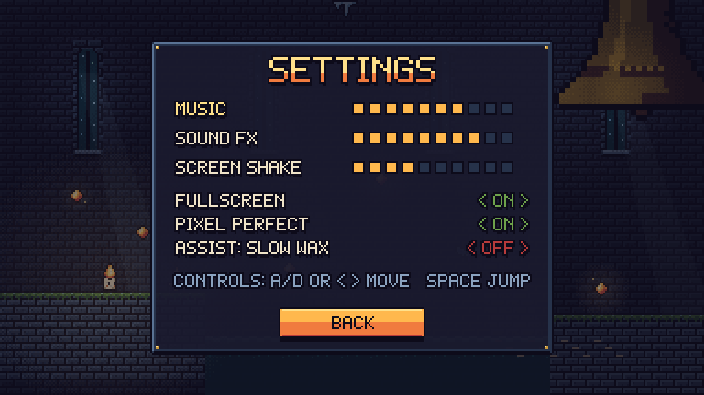

# WICKLIGHT: The Drowned Belfry
### Game Design Document


| | |
|---|---|
| **Assignment theme** | 3. No Risk? No Reward! |
| **Genre** | 2D pixel-art platformer |
| **Platform** | PC (keyboard) |
| **Screen size** | 384 × 216 pixels, shown 5 times bigger (1920 × 1080) |
| **Tile size** | 16 × 16 pixels |
| **Length of one run** | About 2–3 minutes |
| **Players** | 1 |

---

## 1. Choosing the theme

I looked at all three themes:

| Theme | Idea | Decision |
|---|---|---|
| One Button, Big Challenge | A candle that runs by itself and jumps with one key | Fun, but there are not many choices for the player. |
| Think Your Way Out | Puzzles with light and shadow | Good, but every room needs its own puzzle, so it is a lot of work. |
| **No Risk? No Reward!** | **The more embers you carry, the brighter you glow, and the easier enemies find you** | **Chosen.** One simple rule gives the player a real choice again and again. |

In this game the reward is also the risk. Every ember makes your score bigger, but it also makes you easier to find and more costly to lose.

## 2. Short description

You are Pip, the last burning candle in a flooded bell tower. Every ember you collect makes you brighter and worth more points, but it also makes the frost moths notice you. You can keep your points safe at a sconce, or keep going and hope you don't get hit.

## 3. Target audience

- Players aged 10 and up.
- People who like short platform games they can replay to get a better score.
- The game uses only two actions (move and jump), so it is easy to learn.

## 4. Story and setting

For 300 years, the Great Bell of the Belfry of Saint Lume rang every evening. The sound kept the cold fog away from the town below.

One night the sea flooded the tower and the bell stopped ringing. The fog came back, and with it came the **frost moths**, pale creatures that eat light. One by one, the candles in the tower went out.

Only **Pip** is still burning. The last sparks of the old candles, the **embers**, are spread around the tower. If Pip climbs to the top and rings the Great Bell, the fog will go away and the candles will light again.

**Setting:** a dark, half-flooded stone bell tower with cold blue walls, black water and moonlight from tall windows. The only warm colours belong to fire: Pip, embers, sconces and the bronze bell. Warm colours mean you or a reward, and cold colours mean danger.

## 5. Main character: Pip


| | |
|---|---|
| **Who** | A small living candle. Brave, a little greedy, and always aware that the wax will run out. |
| **Goal** | Reach the Great Bell and ring it before the wax runs out. |
| **Look** | A cream wax body, two dot eyes, orange cheeks and a flame on top. The flame leans back when running and turns ice blue when Pip is hurt. |
| **Sprite** | 16 × 16 pixels, 9 frames: idle (2), run (4), jump (1), fall (1), hurt (1). |
| **Hitbox** | 8 × 13 pixels (the red box on the character sheet). |

## 6. Objective

- **Main goal:** reach the Great Bell at the top right of the tower and touch it.
- **Extra goal:** get a high score by collecting embers, keeping them safe at sconces, finding the 3 bell shards and finishing with wax left.

## 7. Core mechanic: Glow

```
  collect an ember                        touch a sconce
  GLOW x1 ──► x2 ──► x3 ──► x4 ──► x5 ─────────────────► BANK
     ▲      (more points, more danger)                    │
     └────────────────────────────────────────────────────┘
                 glow goes back to x1, points are safe
```

- Your **glow level** starts at ×1. It goes up by 1 for every ember you collect, up to ×5.
- An **ember** is worth **20 × your glow level** when you pick it up. Then your glow goes up by 1. For example, the first ember is worth 20, the second 40 and the third 60.
- Ember points go into an **AT RISK** box on the screen. They are not in your score yet.
- **Banking:** touch a sconce. The AT RISK points are added to your score, glow goes back to ×1, and the sconce becomes your restart point.
- **If you get hit**, you lose all AT RISK points and your glow goes back to ×1.

Higher glow also has a cost:

| Glow | Ember value | Frost moth sees you from | Wax burns per second |
|:---:|:---:|:---:|:---:|
| ×1 | 20 | 3.5 tiles | 1.00 s |
| ×2 | 40 | 4.0 tiles | 1.25 s |
| ×3 | 60 | 4.5 tiles | 1.50 s |
| ×4 | 80 | 5.0 tiles | 1.75 s |
| ×5 | 100 | 5.5 tiles | 2.00 s |

So the player keeps asking: *"Do I grab one more ember, or go back to the sconce?"*

## 8. Controls

| Action | Keys |
|---|---|
| Move left / right | A / D or ← / → |
| Jump (hold for a higher jump) | Space, W or ↑ |
| Pause / back | Esc |
| Choose a menu button | Enter |

Pip cannot attack. You can only avoid danger. Banking happens by touching a sconce, so no extra button is needed.

### Movement values

These values make sure every jump in the level is possible.

| Value | Setting | Why |
|---|---|---|
| Run speed | 100 px per second | Crosses one section (24 tiles) in about 4 seconds |
| Gravity | 900 px per second² | Short, quick jumps |
| Jump speed | 310 px per second | Highest jump is about 53 px, which is **3.3 tiles** |
| Longest jump | About 69 px, which is **4.3 tiles** | The level never has a gap wider than 4 tiles |
| Short jump | Letting go of jump early cuts the upward speed in half | Lets you make small hops |
| Coyote time | 0.08 s | You can still jump just after walking off a ledge |
| Jump buffer | 0.10 s | A jump pressed just before landing still works |
| Safe time after a hit | 1.5 s (Pip flashes) | Stops you from being hit twice in a row |

## 9. Rules

1. Pip starts with **3 lives** and **3:00 of wax**.
2. Wax goes down every second. It goes down faster at a high glow (see the table above). A **wax drop** gives back 20 seconds, up to a maximum of 3:00.
3. An **ember** adds points to the AT RISK box and raises glow by 1 (max ×5).
4. A **sconce** banks your AT RISK points, sets glow to ×1 and saves your restart point. It works every time you touch it.
5. A **bell shard** gives 250 points straight into your score. It is safe straight away.
6. **Frost moths and falling icicles:** you lose 1 life and all AT RISK points, glow goes to ×1, and Pip is pushed back. You keep playing from where you are.
7. **Spikes and water:** you lose 1 life and all AT RISK points, glow goes to ×1, and you restart at the last sconce.
8. **Crumbling stones** fall 0.6 seconds after Pip lands on them. They come back after 3 seconds.
9. Ringing the Great Bell banks all your AT RISK points, like a final sconce.

## 10. Win and lose conditions

| | When |
|---|---|
| **Win** | Pip touches the Great Bell. The Victory screen shows your score and rank. |
| **Lose** | Pip has **0 lives** left, **or** the wax reaches **0:00**. The Game Over screen shows your banked score and how far you got. |

## 11. Enemies and obstacles

| | Name | What it does | What it tests |
|---|---|---|---|
|  | **Frost moth** | Floats near its home spot. When Pip comes close (3 tiles + 0.5 tiles per glow level), a "!" appears and it chases Pip at 45 px per second, about half of Pip's speed. It stops chasing 6 tiles away from home. | The main risk: the brighter you are, the sooner it sees you. |
|  | **Icicle** | Hangs from the ceiling. When Pip passes under it, it shakes for 0.4 seconds, then falls. It grows back after 3 seconds. | Don't stop under it. Watch for the shake. |
|  | **Spikes** | Iron spikes on the floor. | Jump timing. |
|  | **Water** | Falling in costs a life. | Gaps are dangerous. |
|  | **Crumbling stone** | Falls 0.6 seconds after you land on it. | Keep moving. |
| | **Wax timer** | Always running, faster at high glow. | Stops the player from playing too slowly and safely. |

## 12. Collectibles

| | Item | In level 1 | What it does |
|---|---|:---:|---|
|  | **Ember** | 24 | 20 × glow points (AT RISK), and glow +1 |
|  | **Wax drop** | 3 | +20 seconds of wax |
|  | **Bell shard** | 3 | +250 points, safe straight away. Each one is on a risky path. |
|  | **Sconce** | 3 | Checkpoint and bank |

## 13. Scoring

| Where points come from | Points |
|---|---|
| Ember | 20 × glow when picked up (only counts after banking) |
| Bell shard | 250 each |
| Wax left when you ring the bell | 5 per second |
| No lives lost | +500 bonus |

**Example (the Victory screen):** 21 embers banked = 1,470 points, plus 2 shards = 500, plus 0:48 wax left = 240, with 1 hit (no bonus). The total is **2,210**, which gives the rank **Blaze**.

| Rank | Score | Flames shown |
|---|---|:---:|
| Ash | 0 – 799 | 1 |
| Ember | 800 – 1,499 | 2 |
| Flame | 1,500 – 1,999 | 3 |
| Blaze | 2,000 – 2,799 | 4 |
| Sun | 2,800 and more | 5 |

The highest possible score is about 3,900. To reach **Sun**, you have to take real risks.

## 14. Difficulty

Level 1 has four sections. Each section is 24 tiles wide and has one job. The full explanation is in [`03_Level_Design/LEVEL_DESIGN.md`](../03_Level_Design/LEVEL_DESIGN.md).

| Section | Job | New thing | Danger |
|---|---|---|---|
| 1. The Wick-Room | **Teach** | Moving, jumping, embers, first sconce | Only water gaps, no enemies |
| 2. Moth Gallery | **Choose** | Frost moth, two paths, first shard | Safe low path or rich high path |
| 3. Flooded Nave | **Pressure** | Crumbling stones, icicles, a moth over water | You must keep moving |
| 4. Bell Climb | **Final test** | Everything together above a floor of spikes | Longest jumps, moth and icicle together |

The difficulty goes up in each section and then drops at each sconce, so the player gets a short rest before the next part.

## 15. Gameplay loop

```
 ┌──────────► EXPLORE the room ──────────┐
 │                                        ▼
 │                        COLLECT embers (more glow, more points, more danger)
 │                                        │
 │                  ┌─────────────────────┴───────────────────┐
 │                  ▼                                         ▼
 │          KEEP GOING (risky)                      BANK at a sconce (safe)
 │      more points, wax burns faster,              points are safe, glow x1
 │      moths see you from further away                       │
 │                  │                                         │
 │         hit? yes → lose the AT RISK points                 │
 │                  │                                         │
 └──────────────────┴─────────────────────────────────────────┘
                        ...until you RING THE BELL
```

- **Every few seconds:** run, jump and collect embers.
- **Every minute:** bank now or keep going? High path or low path?
- **Every run:** learn where the moths are, find all three shards and try for a better rank.

## 16. Screens

| | | |
|---|---|---|
|  Main menu |  Gameplay |  Victory |
|  Game over |  Settings (extra) |  Screen flow |

## 17. Plan for building the game

This project is the design stage. The game itself is not programmed yet. Everything below already has a design and art:

- 1 player character with 5 animations
- 2 enemy types and 3 environment hazards
- 3 collectible types, a checkpoint and the goal
- A 16-tile tileset
- 1 complete level (as a Tiled map, CSV and text file)
- 5 screens, a HUD, buttons and a pixel font

**Suggested order for building it:**
1. Tilemap and collision
2. Pip's movement, using the values in section 8
3. Embers, score and HUD
4. Sconces, banking and restarting
5. Hazards
6. Frost moths with glow-based detection
7. Wax timer
8. Screens and moving between them
9. Extra polish (sound, particles)
