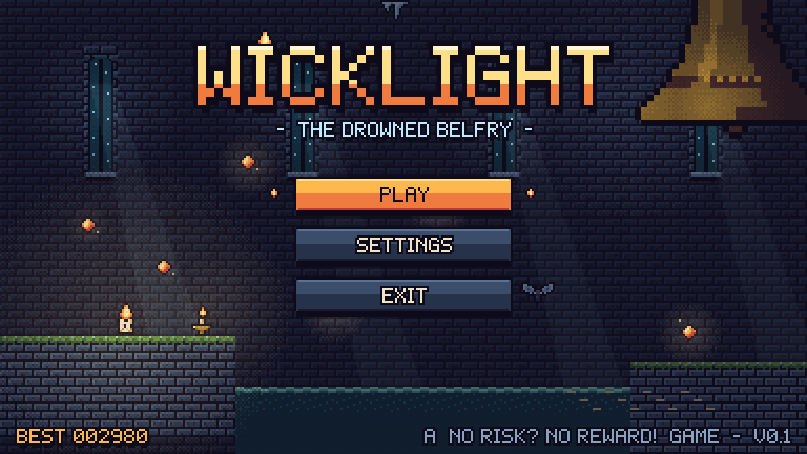
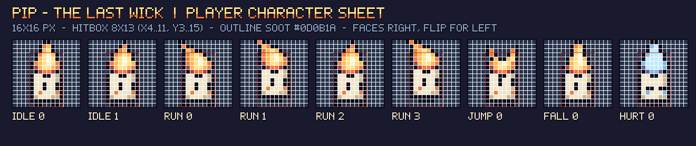
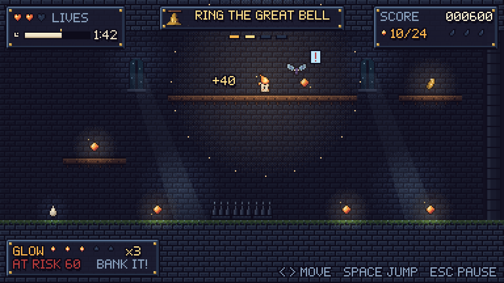
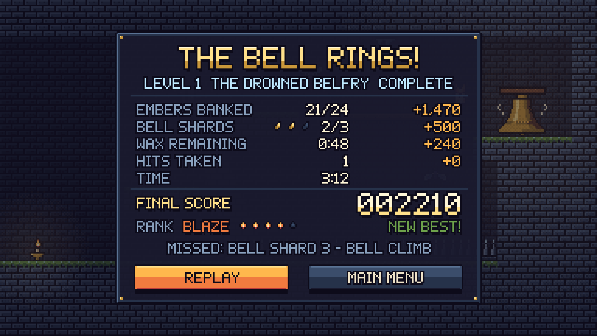
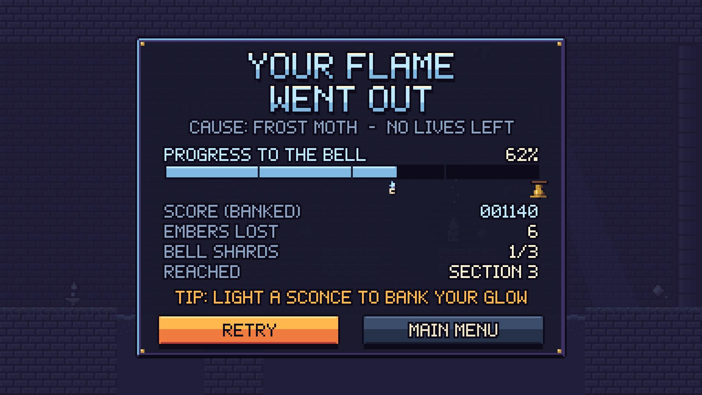
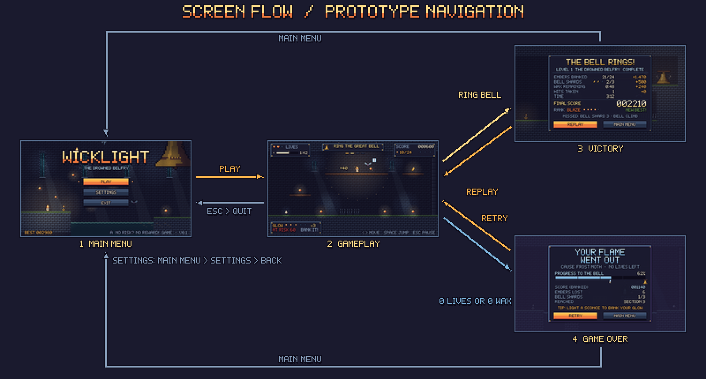

# WICKLIGHT: The Drowned Belfry
### Game Design Document (pre-production) · v0.1



| | |
|---|---|
| **Assignment theme** | **3. No Risk? No Reward!** |
| **Genre** | 2D pixel-art precision platformer with a push-your-luck scoring system |
| **Platform** | PC / web (keyboard or gamepad) |
| **Resolution** | 384 × 216 native, integer-scaled ×5 to 1920 × 1080 |
| **Grid** | 16 × 16 px tiles; level 1 is 96 × 14 tiles |
| **Session length** | 3–5 minutes per run; built for replays and score chasing |
| **Target audience** | Ages 10+. Casual-to-core players who like short, replayable platformers (fans of the "one more run" loop). Good for students to build: a single level, 4 enemy/hazard types and one core mechanic. |

---

## 1. Why this theme?

I compared all three themes before committing:

| Theme | Idea considered | Verdict |
|---|---|---|
| One Button, Big Challenge | Auto-running candle that jumps on one key | Fun, but the depth comes almost entirely from level timing; scoring has no decisions. |
| Think Your Way Out | Light/shadow switch puzzles | Strong, but puzzle design multiplies content cost: every room needs a unique solution. |
| **No Risk? No Reward!** | **Glow mechanic: the more you carry, the brighter (and more hunted) you become** | **Chosen.** One simple rule creates a decision every few seconds, works in any room, and is easy to build. |

The theme is not just "collect stuff and avoid spikes". **The reward itself is the risk.** Every ember Pip picks up makes the score multiplier bigger *and* makes Pip easier to find, faster-burning and more costly to lose.

---

## 2. Elevator pitch

> *You are Pip, the last living candle in a flooded bell tower. Every ember you swallow makes you brighter, worth more and easier to hunt. Bank your glow at a sconce to keep it safe, or keep burning and hope the frost moths don't find you first.*

## 3. Story and setting

For three hundred years the **Belfry of Saint Lume** rang every dusk, and its bell kept the winter fog off the harbour town below. One night the tide came in and never went out. The tower flooded, the bell fell silent, and the fog came back. With it came the **frost moths**, pale creatures that eat light.

The candles of the belfry went out one by one. Only **Pip**, a stubby tallow candle with a stubborn wick, is still burning. Scattered through the drowned halls are **embers**, the last sparks of the old candles. If Pip can climb to the top of the tower and ring the **Great Bell**, the fog will lift and every candle will light again.

**Setting:** a gothic bell tower, half underwater. Cold blue stone, black water and moonlight through tall windows. The only warm colours in the world are fire: Pip, embers, sconces and the bronze bell. That colour rule is the game's visual language (see §12): **warm = you / reward, cold = danger**.

## 4. Main character: Pip



| | |
|---|---|
| **Who** | A small living candle. Brave, a bit greedy, and very aware that wax doesn't last forever. |
| **Purpose** | Reach the Great Bell and ring it before the wax runs out. |
| **Look** | Cream wax body, two dot eyes, amber cheeks, a flame "hairdo" that streams back when running and turns ice-blue when hurt. |
| **Sprite** | 16 × 16 px, 9 frames: idle (2), run (4), jump, fall, hurt. Hitbox 8 × 13 px. |
| **Feedback** | Pip's light radius *is* the glow meter. The brighter Pip gets, the more of the room you can see, and the more moths can see you. |

## 5. Objective

**Primary:** reach the **Great Bell** at the top-right of the tower and touch it to ring it.
**Secondary:** finish with the highest score possible by collecting embers at a high glow, banking them safely, finding the 3 **Bell Shards** and arriving with wax to spare.

## 6. Core mechanic: GLOW

```
            collect ember                          touch a lit sconce
  GLOW x1 ───────────────► x2 ► x3 ► x4 ► x5  ───────────────────────► BANK
     ▲                      (bigger points, more danger)               │
     └───────────────────────────────────────────────────────────────────┘
                      glow resets to x1, points are safe
```

* **Glow level** = 1 + embers collected since the last bank (max **×5**).
* **Ember value** = **20 × glow level at pickup** (20, 40, 60, 80, 100…).
* Ember points go into an **AT RISK** pool shown in the HUD. They are **not** in your score yet.
* **Banking:** touch a sconce (checkpoint). The AT RISK pool is added to your score, glow resets to ×1, and the sconce becomes your respawn point.
* **The price of glow** (all three scale with glow level):

| Glow | Ember value | Moth detection radius | Wax drain per second |
|:---:|:---:|:---:|:---:|
| ×1 | 20 | 3.5 tiles | 1.00 s |
| ×2 | 40 | 4.0 tiles | 1.25 s |
| ×3 | 60 | 4.5 tiles | 1.50 s |
| ×4 | 80 | 5.0 tiles | 1.75 s |
| ×5 | 100 | 5.5 tiles | 2.00 s |

* **Getting hit wipes the AT RISK pool** and resets glow to ×1. A greedy player carrying 400 unbanked points can lose all of it to one moth.

The whole design follows from that: *keep going for one more ember at ×5, or go back to the sconce?*

## 7. Controls

| Action | Keyboard | Gamepad |
|---|---|---|
| Move | A / D or ← / → | Left stick / D-pad |
| Jump (hold for higher) | Space / W / ↑ | A (south button) |
| Pause / back | Esc | Start |
| Menu select | Enter / Space | A |

No attack button. Pip can't fight, only avoid. Banking happens automatically on contact with a sconce, so the controls stay at **move + jump**.

### Movement tuning (so the level is buildable and fair)

| Value | Setting | Why |
|---|---|---|
| Run speed | 100 px/s | Crosses a 24-tile section in about 4 s |
| Gravity | 900 px/s² | Snappy, short airtime |
| Jump velocity | 310 px/s | Apex ≈ 53 px = **3.3 tiles** (level rule: max climb 3 tiles) |
| Flat jump distance | ≈ 69 px = **4.3 tiles** | Level rule: max gap 4 tiles |
| Variable jump | Releasing jump early multiplies upward speed by 0.5 | Short hops for low ceilings |
| Coyote time | 0.08 s | Forgives late jumps off ledges |
| Jump buffer | 0.10 s | Forgives early presses before landing |
| Hurt invulnerability | 1.5 s (Pip flashes) | Prevents double hits |

## 8. Rules

1. Pip starts with **3 lives (hearts)** and **3:00 of wax**.
2. Wax burns every second; higher glow burns it faster (table above). **Wax drops** restore +20 s (max 3:00).
3. **Embers** add points to the AT RISK pool and raise glow by 1 (max ×5).
4. **Sconces** bank the AT RISK pool, reset glow to ×1 and set the respawn point. A sconce banks every time you touch it, not just the first time.
5. **Bell Shards** are worth +250 each and are **banked instantly** (they're the safe reward for a risky path).
6. **Frost moths / falling icicles** (enemy contact): −1 life, lose the AT RISK pool, glow → ×1, knockback, 1.5 s invulnerability. Play continues from where you are.
7. **Spikes / water** (environment): −1 life, lose the AT RISK pool, glow → ×1, respawn at the last sconce.
8. **Crumbling stones** fall 0.6 s after Pip lands on them and reappear after 3 s.
9. Ringing the Great Bell **banks everything automatically**: it works as a final sconce.

## 9. Win and lose conditions

| | Condition |
|---|---|
| **WIN** | Touch the Great Bell → Victory screen with score breakdown and rank. |
| **LOSE** | Lives reach **0**, **or** wax reaches **0:00** → Game Over screen with banked score and progress. |

## 10. Enemies and obstacles

| | Name | Behaviour | Teaches / tests |
|---|---|---|---|
|  | **Frost Moth** | Hovers around its home point (±8 px bob). When Pip enters its detection radius (3 tiles + 0.5 per glow level) it shows a "!" and chases at 45 px/s, about half Pip's speed. It gives up 6 tiles from home. | The core risk: glow makes them notice you sooner. |
|  | **Icicle** | Hangs from the ceiling. When Pip passes within 1 tile beneath, it shakes for 0.4 s, then drops. Regrows after 3 s. | Don't stop under it; the tell rewards players who watch. |
|  | **Iron Spikes** | Static floor hazard. | Jump timing. |
|  | **Black Water** | Instant life loss; respawn at the sconce. | Gaps have weight. |
|  | **Crumbling Stone** | Falls 0.6 s after contact. | Keep moving; don't stop for greed. |
|  | **The Wax Timer** | Always running, faster at high glow. | Prevents "safe" slow play. |

## 11. Collectibles and rewards

| | Item | Count in L1 | Effect |
|---|---|:---:|---|
|  | **Ember** | 24 | 20 × glow points (at risk) and +1 glow |
|  | **Wax Drop** | 3 | +20 s wax |
|  | **Bell Shard** | 3 | +250, banked instantly; each one sits on a risky route |
|  | **Sconce** | 3 | Checkpoint + bank |

## 12. Scoring system

| Source | Points |
|---|---|
| Ember | 20 × glow at pickup (only counts once banked) |
| Bell Shard | +250 each (banked instantly) |
| Wax remaining at the bell | +5 per second |
| No-hit bonus | +500 if no lives lost |

**Example run (Victory screen):** 21 embers banked at an average glow of ×3.5 = **1,470**, plus 2 shards = **500**, plus 0:48 wax left = **240**, with 1 hit (no bonus). Total **2,210 → rank BLAZE**.

| Rank | Score | Flames |
|---|---|:---:|
| Ash | 0 – 799 | 1 |
| Ember | 800 – 1,499 | 2 |
| Flame | 1,500 – 1,999 | 3 |
| Blaze | 2,000 – 2,799 | 4 |
| Sun | 2,800+ | 5 |

The theoretical maximum is about 3,900 (never banking, never hit, every shard). Reaching **Sun** means taking real risks.

## 13. Difficulty progression

Level 1 has four 24-tile sections, each with one job (full annotated breakdown in [`03_Level_Design/LEVEL_DESIGN.md`](../03_Level_Design/LEVEL_DESIGN.md)):

| Section | Role | New element | Pressure |
|---|---|---|---|
| 1. The Wick-Room | **Teach** | Move, jump, embers, first sconce | No enemies; water gaps only |
| 2. Moth Gallery | **Choose** | Frost moth, route fork, first shard | Safe low road vs rich high road |
| 3. Flooded Nave | **Pressure** | Crumbling stones, icicles, moth over water | Must keep moving; wax pickups needed |
| 4. Bell Climb | **Exam** | Everything combined over a spike floor | Max jumps, moth + icicle together |

Difficulty saw-tooths: each section ramps up, then a sconce gives a moment of relief before the next ramp. Future levels can raise moth speed, add more moths per room, shorten the wax timer, or space sconces further apart.

## 14. Core gameplay loop

```
 ┌─────────────► EXPLORE the room ───────────────┐
 │                                               ▼
 │                                     COLLECT embers (glow ↑, value ↑, danger ↑)
 │                                               │
 │                           ┌───────────────────┴───────────────────┐
 │                           ▼                                       ▼
 │                  PUSH ON (greed)                         BANK at a sconce (safe)
 │              more points, faster wax,                    score locked in, glow x1
 │              moths notice from further                           │
 │                           │                                       │
 │                 hit? ─ yes → lose AT RISK pool                    │
 │                           │                                       │
 └───────────────────────────┴───────────────────────────────────────┘
                                   ...until you RING THE BELL
```

**Moment to moment (seconds):** run, jump, grab embers.
**Minute to minute:** bank or push on? High road or low road?
**Run to run:** learn the moth ranges, find all three shards, chase a higher rank.

## 15. Screens

| | | |
|---|---|---|
|  Main menu |  Gameplay |  Victory |
|  Game over |  Settings (bonus) |  Flow |

## 16. Build scope (for the next assignment)

Everything below is already designed and has assets:

- [x] 1 player with 5 animations · [x] 2 enemy types · [x] 3 environmental hazards
- [x] 3 collectible types · [x] checkpoint + exit objects · [x] 16-tile tileset
- [x] 1 complete level (Tiled `.tmj` + CSV + ASCII) · [x] 5 UI screens + HUD kit + bitmap font

**Suggested build order:** (1) tilemap + collision, (2) Pip movement with the tuning table, (3) embers + score + HUD, (4) sconces + banking + respawn, (5) hazards, (6) moths with glow-scaled detection, (7) wax timer, (8) screens and flow, (9) polish (screen shake, particles, sound).

**Stretch goals:** a level select with 3 more towers; a "Cursed Wick" hard mode where banking costs 10 s of wax; online leaderboard.
