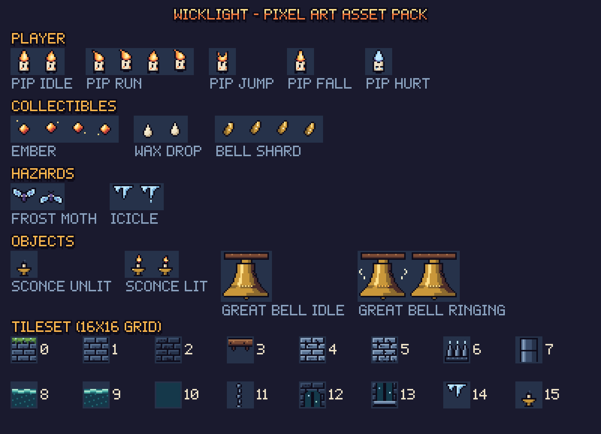
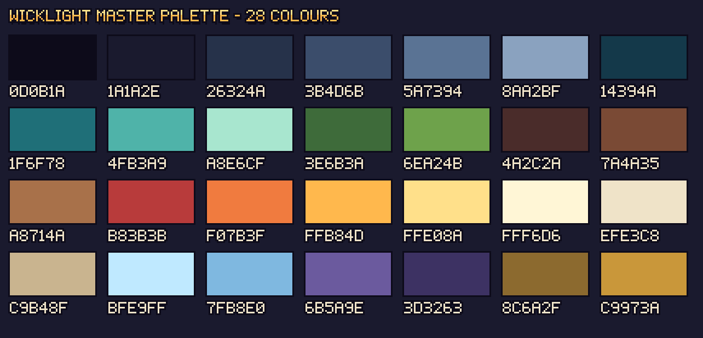
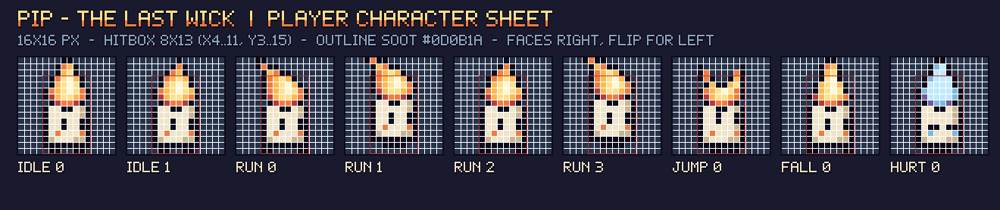
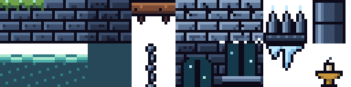

# WICKLIGHT · Pixel Art Asset Pack



Every PNG in this folder is **real, transparent, 1× pixel art** on a **16 × 16 grid** (the Great Bell is 32 × 32). Files ending in `_x4`/`_preview` are enlarged copies for presentations only. Always import the 1× files into Piskel or an engine.

## 1. Visual identity

| | |
|---|---|
| **Art style** | Low-res "night-time cathedral" pixel art: 1 px soot-black outline on every sprite, flat shading with one highlight and one shadow tone per material, no anti-aliasing. |
| **Theme** | Warmth versus cold. **Warm colours belong only to Pip and rewards** (flame, embers, wax, bronze). Everything dangerous or environmental is cold (stone blue, frost, violet moths, teal water). A player can read the screen by colour alone. |
| **Palette** | 28 colours, `palette/wicklight.gpl` (GIMP/Aseprite/Piskel) and `wicklight.hex` (Lospec/Pixelorama). |
| **Lighting** | The world is dark, and light comes from Pip and pickups. Lighting is stepped (4 bands) with ordered 4×4 Bayer dithering at the edges, so it stays pixel-crisp instead of becoming a smooth gradient. Moonlight shafts from windows add cold, low-contrast light. |
| **Backgrounds** | Dark brick wall tiles (`stone_bg`) behind a navy veil, arched windows, pillars and chains. Low contrast so the foreground reads clearly. |
| **Environment** | Mossy stone bricks (walkable), wooden beams (one-way platforms), pale cracked stone (crumbles), iron spikes with frosted tips, black-teal water with a foam line. |
| **Sprite size** | 16 × 16 for everything gameplay-related, 32 × 32 for the goal object, 5–7 px HUD icons, 5 × 7 bitmap font. |
| **Resolution** | Designed for a 384 × 216 game canvas (exactly 24 × 13.5 tiles), integer-scaled ×5 to 1080p. |



| Group | Colours | Used for |
|---|---|---|
| Outline | `#0D0B1A` | All outlines, mortar, text outline |
| Stone | `#1A1A2E` `#26324A` `#3B4D6B` `#5A7394` `#8AA2BF` | Walls, floors, UI panels |
| Water | `#14394A` `#1F6F78` `#4FB3A9` `#A8E6CF` | Water, dew, moss highlights |
| Moss | `#3E6B3A` `#6EA24B` | Walkable top edges ("you can stand here") |
| Wood | `#4A2C2A` `#7A4A35` `#A8714A` | Beams, bell yoke |
| Flame | `#B83B3B` `#F07B3F` `#FFB84D` `#FFE08A` `#FFF6D6` | Pip, embers, sconces, UI accent |
| Wax | `#EFE3C8` `#C9B48F` | Pip's body, wax drops, UI text |
| Frost | `#BFE9FF` `#7FB8E0` | Moths, icicles, game-over grade |
| Moth | `#6B5A9E` `#3D3263` | Moth bodies, frost UI panel |
| Bronze | `#8C6A2F` `#C9973A` | Bell, bell shards, panel rivets |

## 2. Contents

### Player · `sprites/player/`


| Animation | Frames | FPS | Notes |
|---|:---:|:---:|---|
| `pip_idle` | 2 | 3 | Flame flicker |
| `pip_run` | 4 | 10 | Flame streams back, body bobs 1 px on passing frames |
| `pip_jump` | 1 | – | Eyes look up, flame splits upward |
| `pip_fall` | 1 | – | Stretched flame, feet apart |
| `pip_hurt` | 1 | – | Flame turns frost-blue, eyes shut |

### Collectibles · `sprites/collectibles/`
`ember` (4 frames, spark orbits), `wax_drop` (2, bob), `bell_shard` (4, glint travels down).

### Hazards · `sprites/hazards/`
`frost_moth` (2-frame wing flap), `icicle` (2: idle / drip forming = "about to fall" tell).

### Objects · `sprites/objects/`
`sconce_unlit`, `sconce_lit` (2), `great_bell_idle` (32×32), `great_bell_ringing` (2, with sound-wave pixels).

### Tileset · `tileset/wicklight_tileset.png` (8 × 2 tiles, 128 × 32 px)



| Index | Tile | Collision type |
|:---:|---|---|
| 0 | stone_top (moss edge) | solid |
| 1 | stone | solid |
| 2 | stone_bg | background |
| 3 | plank | one-way platform |
| 4 | crumble | crumble (solid, timed) |
| 5 | crumble_breaking | crumble (swap 0.3 s before falling) |
| 6 | spikes | hazard |
| 7 | pillar | background |
| 8–9 | water_surface (2-frame animation) | hazard_water |
| 10 | water_fill | hazard_water |
| 11 | chain | decor |
| 12–13 | window_top / window_bottom | background |
| 14 | icicle_mount (spawn marker) | hazard spawn |
| 15 | sconce_unlit (placement marker) | checkpoint |

`tileset/tiles/` has every tile as its own file, and `tileset/tileset.json` lists names and types.

### Sprite sheets · `spritesheets/`
* `*_stripN.png`: one horizontal strip per animation (N frames, 16 px each). This is the most engine-friendly format.
* `wicklight_master_spritesheet.png`: every 16 × 16 animation in one sheet (one animation per row, up to 4 columns).
* `spritesheets.json`: frame size, frame count, FPS and loop flag for every strip, plus the row map for the master sheet.

### UI kit · `ui/`
Buttons (idle and hover for PLAY, SETTINGS, EXIT, REPLAY, RETRY, MAIN MENU), 9-slice panels (stone and frost, 48 px, 4 px border), hearts, ember/shard/clock icons, and the **Belfry 5×7** bitmap font sheet (`font_belfry5x7_sheet.png`, 8 × 10 cells, character order in `font_belfry5x7_order.txt`).

## 3. Importing

### Piskel (piskelapp.com)
1. **Open a sprite:** *Import* (right panel) → *Browse images* → choose a 1× PNG such as `sprites/player/pip_idle_0.png`. Keep the size at 16 × 16.
2. **Import a whole animation:** *Import* → choose a strip like `spritesheets/pip_run_strip4.png` → select **"Import as spritesheet"** → frame width **16**, height **16**. Piskel splits it into 4 frames. Set FPS from the table above.
3. **Palette:** *Palettes* → *Import* → `palette/wicklight.gpl`. Use only these colours when editing, so new art stays on-palette.
4. **Export** to your engine with *Export → PNG → Spritesheet* (horizontal strip), which keeps the same format.

### Unity (2D)
1. Drag `02_Pixel_Art_Assets` into `Assets/`.
2. Select all PNGs → *Texture Type* **Sprite (2D and UI)**, *Pixels Per Unit* **16**, *Filter Mode* **Point (no filter)**, *Compression* **None**.
3. For strips: *Sprite Mode* **Multiple** → *Sprite Editor* → *Slice* → *Grid By Cell Size* 16 × 16.
4. Tileset: slice `wicklight_tileset.png` the same way, then *Window → 2D → Tile Palette* → drag the slices in.
5. Camera: orthographic, size **6.75** (216 px ÷ 16 ÷ 2), Pixel Perfect Camera with reference resolution 384 × 216.

### Godot 4
1. Copy the folder into the project. *Project Settings → Rendering → Textures → Default Texture Filter* = **Nearest**.
2. *Display → Window*: viewport **384 × 216**, *Stretch Mode* **canvas_items** (or viewport), *Scale Mode* **integer**.
3. `AnimatedSprite2D` → *SpriteFrames* → **Add frames from sprite sheet** → choose a strip → 4 horizontal × 1 vertical.
4. `TileMapLayer` → new TileSet, tile size 16 × 16 → add `wicklight_tileset.png` → paint physics on tiles 0, 1, 3 (one-way), 4–5.

### GameMaker / Construct / Phaser
Use the strips (`*_stripN.png`) directly: every one is N × 16 px wide and 16 px tall with no padding. Phaser example: `this.load.spritesheet('pip_run', 'pip_run_strip4.png', { frameWidth: 16, frameHeight: 16 })`.

### Tiled
`03_Level_Design/data/level_01.tmj` already references `wicklight_tileset.png` with a relative path. Open it in Tiled to edit the level, then export it to your engine.

## 4. Regenerating

All art is generated from source in `tools/wl.py` (sprite pixel maps and procedural tiles), so the style stays consistent. Edit a pixel map there and run:

```bash
python3 tools/build_all.py
```
