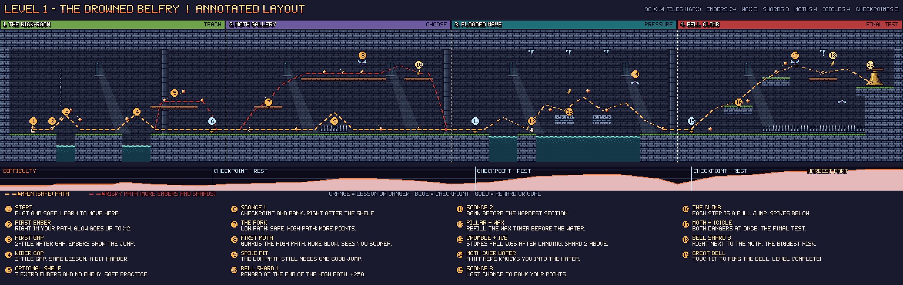
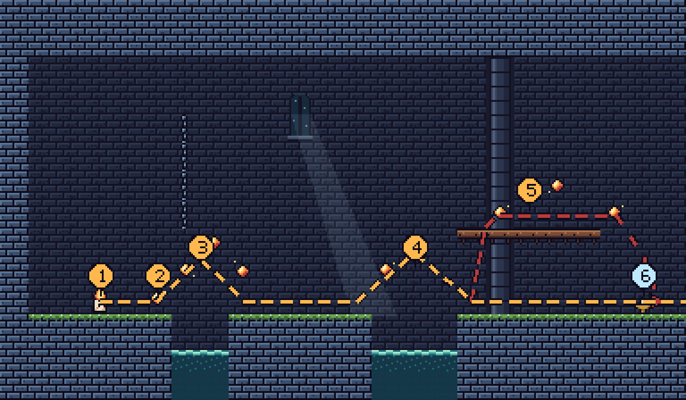
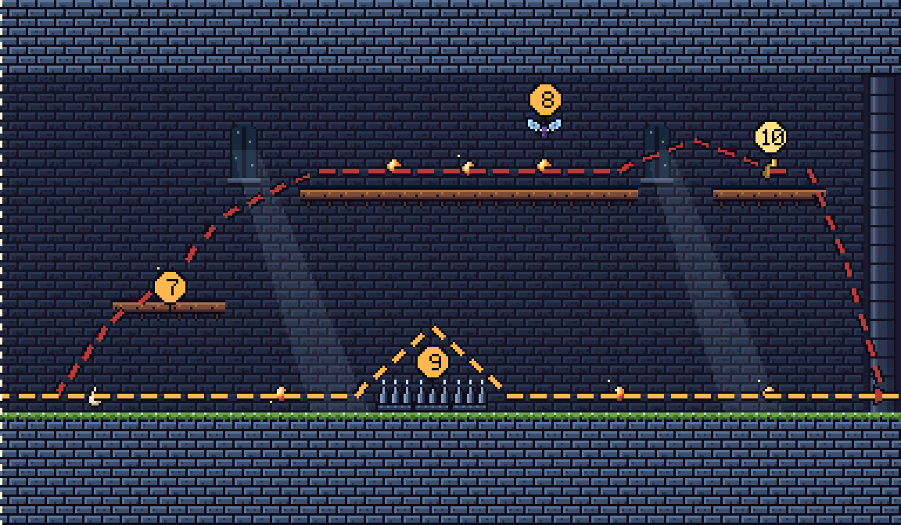
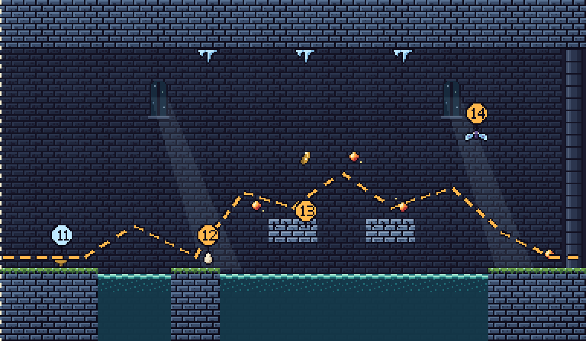
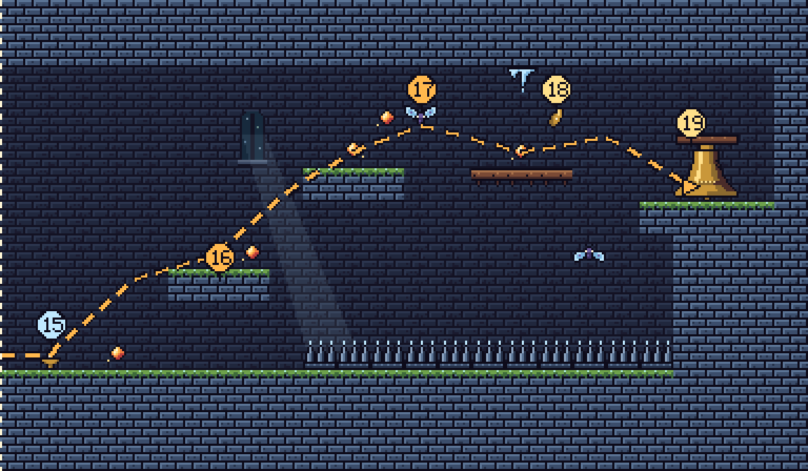

# Level 1: The Drowned Belfry
### Level Design



| | |
|---|---|
| **Size** | 96 × 14 tiles (1536 × 224 pixels). Each tile is 16 × 16 pixels. |
| **Sections** | 4 sections, each 24 tiles wide. One section fills exactly one screen. |
| **Contents** | 24 embers · 3 wax drops · 3 bell shards · 4 frost moths · 4 icicles · 3 sconces · 1 Great Bell |
| **Target time** | About 1:30 for a safe run, about 2:15 if you collect everything. The wax starts at 3:00. |
| **Jump rules** | Platforms are never more than **3 tiles** higher than the last one, and gaps are never wider than **4 tiles**. Pip can jump 3.3 tiles high and 4.3 tiles far, so every jump is possible. |

## Files in this folder

| File | What it is |
|---|---|
| `level_01_annotated_design_x2.png` | The full map with the main path (orange), the risky paths (red), 19 numbered notes and a difficulty line |
| `level_01_map_clean_x3.png` | The map without notes |
| `level_01_map_grid_coords.png` | The map with a tile grid and X/Y numbers, for rebuilding it in a game engine |
| `section_1…4_*_x3.png` | Close-ups of each section |
| `data/level_01.txt` | The level as text (one letter per tile). The images are made from this file. |
| `data/level_01.tmj` | The level for the **Tiled** map editor |
| `data/level_01_terrain.csv`, `data/level_01_background.csv` | Tile numbers for each layer (−1 means empty) |
| `data/level_01_entities.json` | The position of every object |

### Letters used in `level_01.txt`

```
#  stone            =  wooden plank       %  crumbling stone
^  spikes           ~  water surface      w  deep water
c  chain (decor)    P  player start       e  ember
d  wax drop         b  bell shard         M  frost moth
I  icicle           S  sconce             G  Great Bell (2x2 tiles)
```

---

## Beginning, middle and end

```
Difficulty
 10 |                                                         ___
    |                                              __/‾‾‾‾‾‾‾‾   |  ← hardest part
    |                          /‾‾‾‾\        /‾‾‾‾                |
    |            /‾‾‾\        /      \      /                     |
    |  __/‾‾\___/     \_____/        \____/                      |
  1 |_/  TEACH    ↑   CHOOSE    ↑   PRESSURE   ↑   FINAL TEST     |
     0         sconce 1      sconce 2      sconce 3            bell (96)
```

Each section first shows the player something new, then mixes it with older things, then tests it. Every section ends with a sconce. After a hard part, the player gets a short rest and a chance to bank. This choice comes up three times, and the stakes get higher each time.

---

## Section 1: The Wick-Room (tiles 0–23) · Teach



| # | Where | What and why |
|---|---|---|
| **1 START** | (3,10) | A flat, safe floor with a wall behind the player. Nothing can hurt you, so the first seconds are only for learning to move. |
| **2 FIRST EMBER** | (5,10) | It is right in your path, so you can't miss it. When you collect it, the glow meter goes to ×2 and Pip's light gets bigger. This teaches the main mechanic without any text. |
| **3 FIRST GAP** | tiles 6–7 | A 2-tile gap over water. Two embers float in an arc over the gap, so following the embers is the jump. This teaches jumping and that water is dangerous. |
| **4 WIDER GAP** | tiles 13–15 | A 3-tile gap. The same lesson, but harder. One ember marks the top of the jump. |
| **5 OPTIONAL SHELF** | planks at tiles 16–20 | The first optional reward: 3 embers on a shelf you need a full jump to reach. **There is no enemy here**, so the first taste of greed is safe. |
| **6 SCONCE 1** | (22,10) | It comes right after the shelf, so the player arrives with up to 8 embers and a high glow. Touching it shows the score jump and the glow reset. **This teaches banking at the moment it matters most.** |

**How you can fail here:** only by falling in the water (−1 life, restart at the start). The danger is low on purpose.

---

## Section 2: Moth Gallery (tiles 24–47) · Choose



| # | Where | What and why |
|---|---|---|
| **7 THE FORK** | plank at (27–29, 8) | The path splits in two. **Low path:** walk along the floor, 3 embers, 1 wax drop and one spike pit. **High path:** jump up the planks, 4 embers and a bell shard, but a frost moth guards it. You can see both paths at once, so you can choose. |
| **8 FIRST MOTH** | (38,3) | It floats just above the embers on the high path. At glow ×1 it only sees 3.5 tiles, so it barely reaches the planks. At ×4 or ×5 it sees the whole plank. A player who skipped sconce 1 arrives with a high glow and gets chased. A player who banked can sneak past. **This tests the banking lesson straight away.** |
| **9 SPIKE PIT** | tiles 34–36 | The low path isn't free: there is one 3-tile spike jump. The spikes also punish falling off the high path. |
| **10 BELL SHARD 1** | (44,4) | At the end of the high path, across a 2-tile jump. It is safe straight away, so the high path pays off even if the moth hits you later. |

**Where the rewards are:** the risky high path is worth about twice as much (4 embers at a rising glow plus 250 for the shard). The low path has 3 embers and the wax drop. The wax drop is a hint that this is the steady path.

**How you can fail here:** touching the moth (lose AT RISK points) or the spikes (lose a life and restart at sconce 1).

---

## Section 3: The Flooded Nave (tiles 48–71) · Pressure



| # | Where | What and why |
|---|---|---|
| **11 SCONCE 2** | (50,10) | It is placed *before* the hard part, so a mistake here doesn't send you back through section 2. |
| **12 PILLAR + WAX** | (55–56, 10) | A safe stone pillar with a wax drop, so you can refill before the part where time matters most. |
| **13 CRUMBLE + ICE** | crumbling stones at (59–60, 9) and (63–64, 9) | The only places to stand over 11 tiles of water **fall 0.6 seconds after you land**, and **icicles hang above them**. You can't wait, and you can't stand still to plan a jump. **Bell Shard 2** is 2 tiles above the first crumbling stone, so you have to jump up from a falling stone to get it. |
| **14 MOTH OVER WATER** | (67,5) | It guards the landing. If it hits you here, the push-back can knock you into the water, so one mistake can cost twice. With a high glow, the moth sees you while you are still on the crumbling stones. |

**Why it is harder:** this is the first section where standing still is punished (crumbling stones and wax), and where a moth hit can lead to falling in the water.

---

## Section 4: Bell Climb (tiles 72–95) · Final test



| # | Where | What and why |
|---|---|---|
| **15 SCONCE 3** | (73,10) | The last chance to bank. After this you climb over a floor of spikes, so smart players bank here. The 11 tiles of spikes ahead are the hint. |
| **16 THE CLIMB** | ledges (77–79, 8) → (81–83, 5) → plank (86–88, 5) | Each step is exactly 3 tiles higher, which is Pip's highest jump. If you miss a step, you fall onto the spikes. The jumping lessons from section 1 now have to be done perfectly. |
| **17 MOTH + ICICLE** | moths at (84,3) and (89,7), icicle at (87,2) | The first time both kinds of danger are on the same screen. You have to time your jump between them. |
| **18 BELL SHARD 3** | (88,3) | It floats right in the moth's area above the plank. Grabbing it means jumping at the worst moment. This is the biggest risk in the level. |
| **19 THE GREAT BELL** | (92–93, 4–5) on the tower ledge | Touch it to ring it. It banks all your points and ends the level. The last jump is only 2 tiles, so the level ends on a happy moment, not a frustrating one. |

---

## Player paths

- **Main path (orange):** floor → water gaps → sconce 1 → low path → spike jump → sconce 2 → pillar → crumbling stones → sconce 3 → three-step climb → bell. It only uses 2–3 tile jumps. A first-time player can finish with about 15 embers.
- **Risky paths (red):** the shelf in section 1, the high path in section 2, and the shard jumps in sections 3 and 4. You need all of them to get the rank **Sun**.

## How the level teaches without text

| Lesson | Taught by | Tested by |
|---|---|---|
| Embers give glow | Ember 2, in your path | The fork in section 2 |
| Jumping | The ember arc over gap 1 | The steps in the Bell Climb |
| Banking | Sconce 1, right after the bonus shelf | The moth right after it, which punishes a high glow |
| Water and spikes hurt | The small 2-tile water gap | The 11-tile spike floor in the climb |
| Moths follow light | One moth with a clear "!" warning | The moth + icicle combination |
| Keep moving | The wax timer | The crumbling stones |

## Winning and losing

- **Win:** reach the bell with at least 1 life and some wax left. Your score is your banked points + shards + wax bonus (+ the no-hit bonus).
- **Lose:** lose all 3 lives, or let the wax run out. Spikes and water send you back to the last sconce. Enemies push you back. AT RISK points that you lose are gone for good, so you can finish the level and still get a low score if you were greedy at the wrong time.
