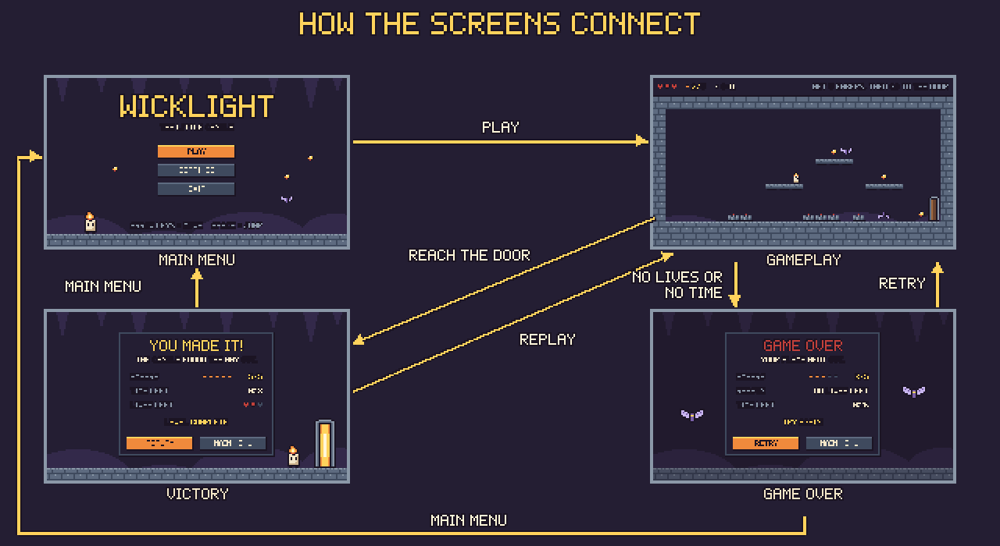
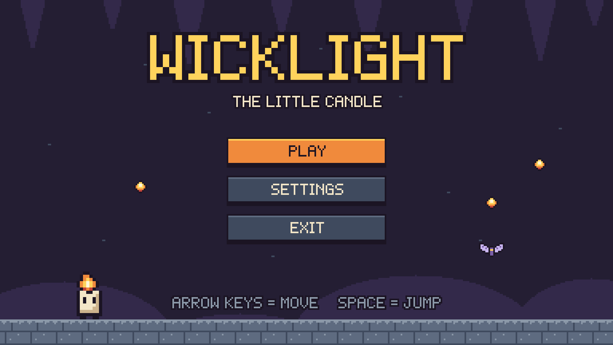
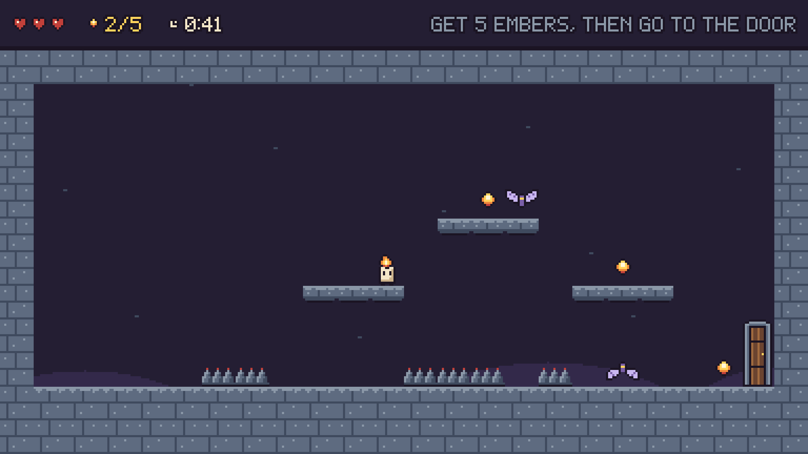
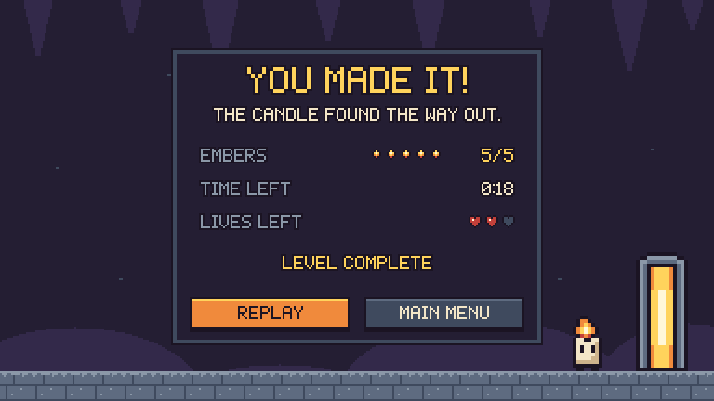
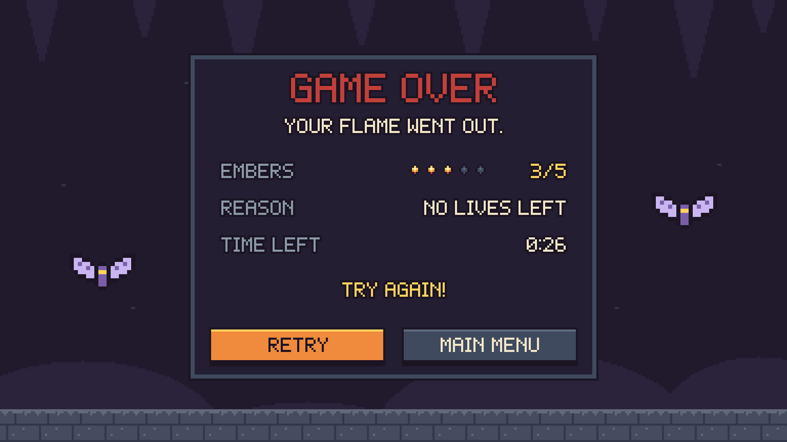

# WICKLIGHT – UI Screens and Prototype

There are 4 screens: **Main Menu**, **Gameplay**, **Victory** and **Game Over**. All screens use the same 16 colours, the same pixel font, the same buttons and the same dark panel.

| File | Size |
|---|---|
| `screens/01_main_menu.png` | 1920 × 1080 |
| `screens/02_gameplay.png` | 1920 × 1080 |
| `screens/03_victory.png` | 1920 × 1080 |
| `screens/04_game_over.png` | 1920 × 1080 |
| `screen_flow.png` | How the screens connect |
| `prototype/index.html` | Clickable HTML prototype |

The screens are drawn at 384 × 216 pixels and saved 5 times bigger, so the pixels stay sharp.

## Screen 1: Main Menu

- Game title "WICKLIGHT" and "THE LITTLE CANDLE"
- A simple cave background with the candle, embers and a moth
- PLAY, SETTINGS and EXIT buttons
- The controls at the bottom: arrow keys to move, space to jump

## Screen 2: Gameplay

The whole level fits on the screen. The bar at the top shows:
- **Lives:** 3 hearts
- **Embers:** 0/5 (the run has just started)
- **Timer:** 0:58 (the timer starts at 1:00, which is 60 seconds)
- **Goal:** "GET 5 EMBERS, THEN GO TO THE DOOR"

In the level you can see the candle hopping towards the first ember, all 5 embers, the 3 platforms, 2 moths, 3 spike groups and the exit door.

## Screen 3: Victory

- "YOU MADE IT!" and "THE CANDLE FOUND THE WAY OUT."
- Embers 5/5, time left 0:18, lives left 2 of 3
- "LEVEL COMPLETE"
- REPLAY and MAIN MENU buttons

## Screen 4: Game Over

- "GAME OVER" and "YOUR FLAME WENT OUT."
- Progress: embers 3/5, the reason (no lives left) and the time left (0:26)
- RETRY and MAIN MENU buttons

## Screen links

| From | Click | Goes to |
|---|---|---|
| Main Menu | PLAY | Gameplay |
| Gameplay | The exit door | Victory |
| Gameplay | A moth or spikes | Game Over |
| Victory | REPLAY | Gameplay |
| Victory | MAIN MENU | Main Menu |
| Game Over | RETRY | Gameplay |
| Game Over | MAIN MENU | Main Menu |

SETTINGS and EXIT are on the menu, but settings are not part of this assignment. They are placeholders: in Figma they do nothing, and in the HTML prototype they show a short message.

**The prototype is clicked, not played.** The arrow keys and the spacebar are the controls of the real game, which is not programmed yet. In Figma's Present mode, the arrow keys and the spacebar do something different: Figma uses them to jump to the next or previous screen. So use the mouse to click the buttons, the door, the moths and the spikes.

## HTML prototype

Open `prototype/index.html` in a web browser by double-clicking it.
- Click the buttons and the door, moths or spikes on the gameplay screen.
- Buttons light up when your mouse is over them.
- Tick **Show click areas** to see everything you can click.
- **Enter** presses the main button. **Esc** goes back to the main menu.

## Figma prototype

**Figma link:** make your own new Figma file and put its share link in `05_Documentation/Submission_Document.md`. (An older Figma file from an earlier version of this project exists in a different Figma account. It shows the old game, so do not use it.)

How to build it: run the small Figma plugin in `figma_plugin/`. It builds the 4 screens, the buttons, all 11 links and the starting screen in about 3 minutes. Steps: **[`Figma_Rebuild_Guide.md`](Figma_Rebuild_Guide.md)** (the guide also has a manual way).
