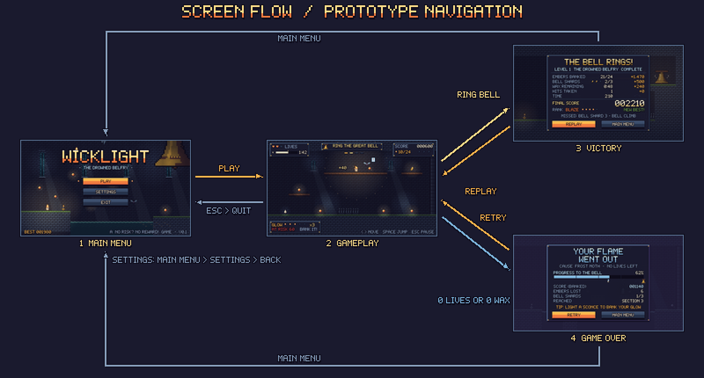
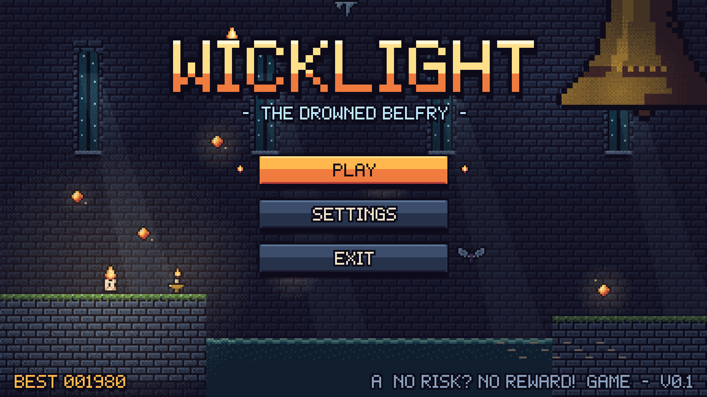
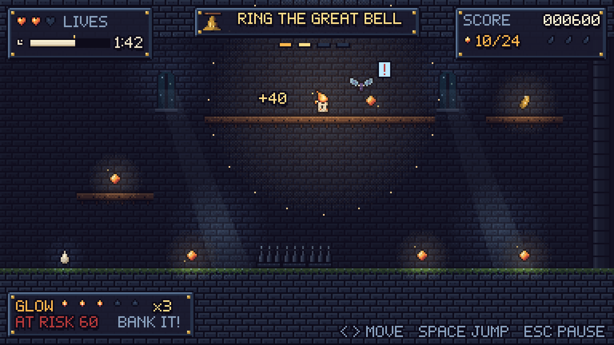
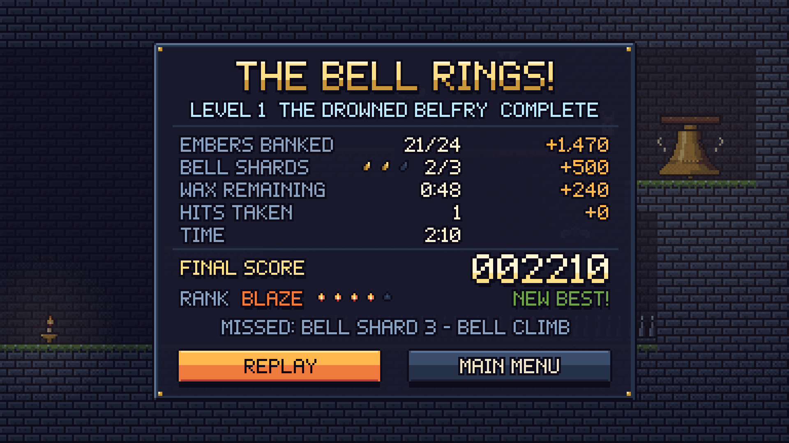
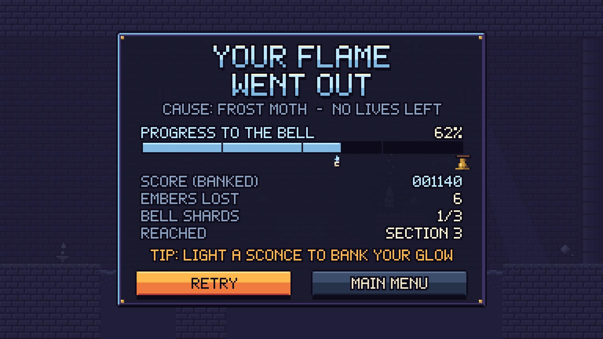

# WICKLIGHT: Game UI and Prototype

There are two versions of the prototype:

1. **Figma prototype:** https://www.figma.com/design/E1gSy4J9rj3xGSCBafzJrX
2. **HTML prototype:** open `prototype/index.html` in a web browser.

Both have the same five screens and the same links.

## 1. How the screens connect

| From | Action | Goes to |
|---|---|---|
| Main Menu | PLAY | Gameplay |
| Main Menu | SETTINGS | Settings → BACK → Main Menu |
| Main Menu | EXIT | In the HTML prototype, a "Thanks for playing" message. In Figma it has no link. |
| Gameplay | Click the frost moth or the spikes (or press L) | Game Over |
| Gameplay | Click the bell shard path on the right (or press W) | Victory |
| Gameplay | Esc | Main Menu |
| Victory | REPLAY | Gameplay |
| Victory | MAIN MENU | Main Menu |
| Game Over | RETRY | Gameplay |
| Game Over | MAIN MENU | Main Menu |

Keys that work on most screens: **Enter** presses the main button and **Esc** goes back to the menu.

## 2. Figma prototype

**Link:** https://www.figma.com/design/E1gSy4J9rj3xGSCBafzJrX

Open the file and press **Present (▶)**. The prototype starts on the Main Menu.

| Page in Figma | What is on it |
|---|---|
| **🔥 Prototype** | The 5 screens (1920 × 1080): *1 · Main Menu*, *2 · Gameplay*, *3 · Victory*, *4 · Game Over*, *5 · Settings*, all linked together |
| **Components (pixel art + UI)** | Every tile and sprite rebuilt pixel by pixel as Figma components, a `UI/Button` component (normal and selected, with an editable label) and two panel components |
| **Art Assets (HUD icons)** | The small HUD icons (hearts, clock, ember, shard, glow flames, bell) |
| Local variables | **Wicklight Palette**: the 28 colours |

Everything in the Figma file can be edited. The game scenes are built from tile components, so changing one tile component changes it on every screen. All text is real text using the Silkscreen pixel font.

The Figma screens look very close to the PNG screens, but there are some small differences:
- The lighting is softer.
- The logo uses the Silkscreen font instead of the custom WICKLIGHT pixel font.

## 3. HTML prototype

Open `prototype/index.html` in a browser by double-clicking it. You don't need internet, except for loading the page fonts.

- Click the buttons on each screen. They light up when your mouse is over them.
- If you click an empty area, all clickable areas flash for a moment. You can also tick **Show hotspots**.
- The buttons under the screen let you jump straight to any screen.
- The screens are animated: flames flicker, moth wings flap and the water moves.

## 4. The screens

All screens are drawn at **384 × 216** pixels and saved 5 times bigger (**1920 × 1080**) in `screens/`. They all use the same colours, font, panels and buttons.

### Screen 1: Main Menu

- **Logo:** "WICKLIGHT" in big pixel letters, yellow on top and orange below. Pip's flame sits above the letter I.
- **Background:** the inside of the tower, with moonlit windows, Pip next to a lit sconce, dark water, floating embers, a frost moth and the Great Bell in the top right. The goal can be seen from the very first screen.
- **Buttons:** PLAY (selected), SETTINGS and EXIT. Small flames show which button is selected.
- **Bottom:** the best score on the left, and the theme and version on the right.

### Screen 2: Gameplay

This screen shows section 2 of the level (Moth Gallery). Pip is on the high path with a glow of ×3, and the frost moth has just seen Pip.

| Part of the screen | What it shows |
|---|---|
| Top left | **Lives** (2 of 3 hearts) and the **wax timer** (a melting candle bar and 1:42) |
| Top middle | **Goal:** "RING THE GREAT BELL", plus 4 small bars for the 4 sections (this is section 2) |
| Top right | **Score** (banked points), **embers** collected (10/24) and **bell shards** (0 of 3) |
| Bottom left | **Glow ×3** (3 of 5 flames lit), **AT RISK 60** and "BANK IT!" |
| Bottom right | Control hints |
| In the level | A "!" over the moth (it has seen Pip), a dotted circle showing how far moths can see Pip, and a "+40" for the ember Pip just picked up |

The glow box is at the bottom left, near Pip's feet, because it shows the most important choice in the game: bank now or keep going.

### Screen 3: Victory

Shows the score for each part (embers banked, shards, wax bonus, hits), the **final score** (2,210), the **rank** (BLAZE, 4 of 5 flames) and "NEW BEST!". It also shows a hint about the missed shard, to give the player a reason to try again. Buttons: **REPLAY** and **MAIN MENU**. The ringing bell can be seen behind the panel.

### Screen 4: Game Over

The whole screen turns **cold blue**, because Pip's flame has gone out. It shows the cause, a **progress bar** to the bell (62%), the banked score, the number of embers lost, the shards found, the section reached and a tip. Buttons: **RETRY** and **MAIN MENU**.

### Extra screen: Settings
Volume bars (music, sound effects, screen shake), on/off options (fullscreen, pixel-perfect, an easier "slow wax" option) and the controls. This screen is an extra and was not required.

## 5. UI style

- **Font:** "Belfry 5×7", a pixel font made for this game (see `02_Pixel_Art_Assets/ui/`). Normal size for small text, 2× for titles and 4× for the logo. Text always has a dark outline and a shadow, so it is easy to read on any background.
- **Colour meanings:** orange and yellow mean a reward or the main button. Light blue means checkpoints, information or Game Over. Red means risk (the AT RISK points). Green means good news (NEW BEST, ON).
- **Panels and buttons:** the stone panel is for normal UI and the frost panel is for the Game Over screen. Selected buttons are orange with dark text, and other buttons are stone grey with light text.
- **Layout:** the HUD panels sit in the four corners, so the middle of the screen stays clear for the game.

## 6. Making your own Figma copy (optional)

If you want to build the Figma prototype again yourself from the PNG files:

1. Make 5 frames of **1920 × 1080** and put each `screens/*_1920x1080.png` into its frame at position (0,0).
2. Draw see-through rectangles over the buttons at these positions and add **On click → Navigate to**:

| Frame | Clickable area | X | Y | W | H | Goes to |
|---|---|---:|---:|---:|---:|---|
| Main Menu | PLAY | 700 | 420 | 520 | 95 | Gameplay |
| Main Menu | SETTINGS | 700 | 540 | 520 | 95 | Settings |
| Settings | BACK | 760 | 840 | 400 | 95 | Main Menu |
| Gameplay | Frost moth | 1020 | 180 | 200 | 150 | Game Over |
| Gameplay | Spikes | 790 | 740 | 260 | 80 | Game Over |
| Gameplay | Right side / shard | 1500 | 220 | 420 | 260 | Victory |
| Victory | REPLAY | 430 | 850 | 500 | 95 | Gameplay |
| Victory | MAIN MENU | 990 | 850 | 500 | 95 | Main Menu |
| Game Over | RETRY | 430 | 860 | 500 | 95 | Gameplay |
| Game Over | MAIN MENU | 990 | 860 | 500 | 95 | Main Menu |

3. Set the Main Menu as the starting point and press ▶.
