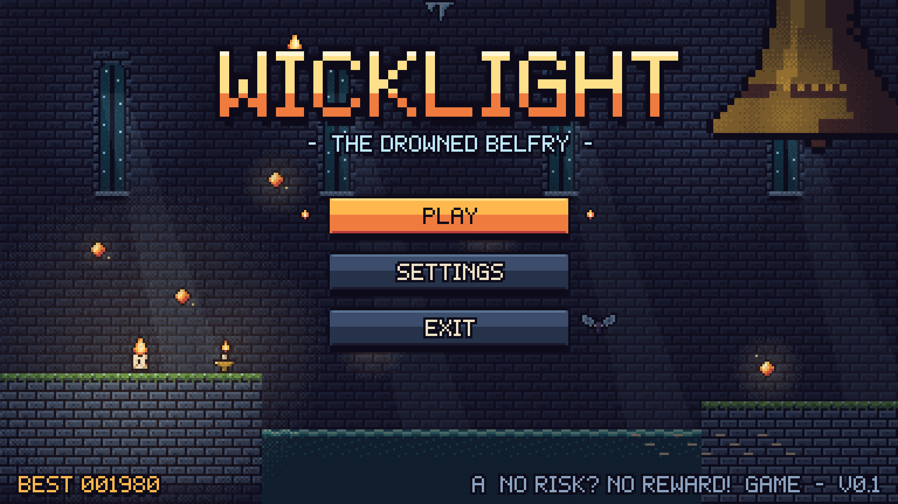
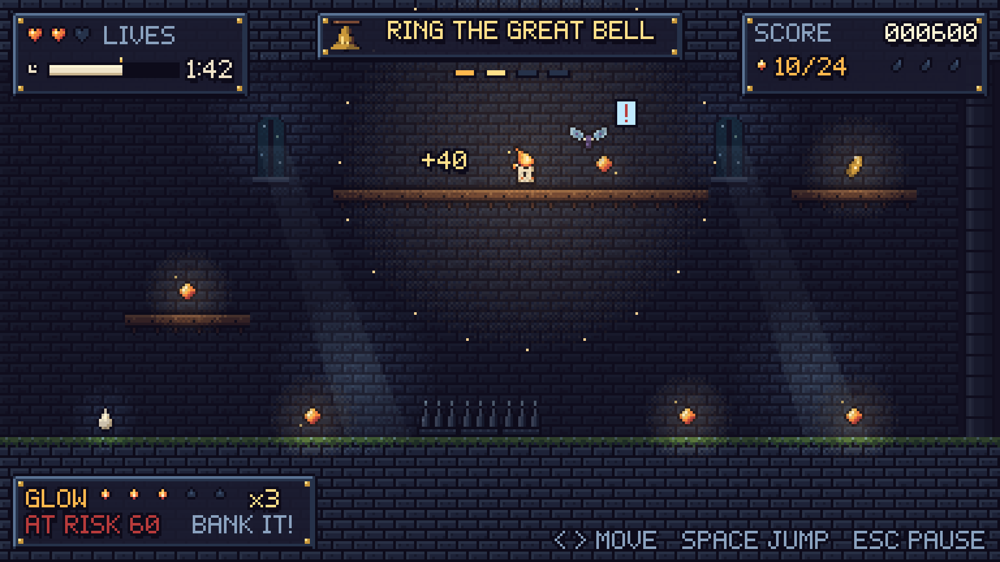
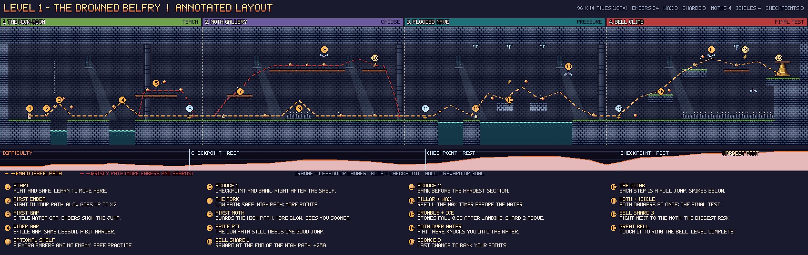

# WICKLIGHT: The Drowned Belfry



**A 2D pixel-art game design project.**
Assignment theme: **No Risk? No Reward!**

You are Pip, the last burning candle in a flooded bell tower. Every ember you collect makes you brighter and worth more points, but it also makes the frost moths notice you. Keep your points safe at a sconce, or keep going and hope you don't get hit. Climb to the top and ring the Great Bell to win.



## Project folders

| Folder | What is inside | Start with |
|---|---|---|
| [`01_Game_Concept/`](01_Game_Concept) | Story, character, rules, controls, scoring and the gameplay loop | [`WICKLIGHT_Game_Design_Document.md`](01_Game_Concept/WICKLIGHT_Game_Design_Document.md) |
| [`02_Pixel_Art_Assets/`](02_Pixel_Art_Assets) | Sprites, sprite sheets, tileset, colour palette and UI pieces | [`README.md`](02_Pixel_Art_Assets/README.md) |
| [`03_Level_Design/`](03_Level_Design) | The level map, the annotated map and the level data | [`LEVEL_DESIGN.md`](03_Level_Design/LEVEL_DESIGN.md) |
| [`04_UI_and_Prototype/`](04_UI_and_Prototype) | The game screens and the HTML prototype | [`UI_AND_PROTOTYPE.md`](04_UI_and_Prototype/UI_AND_PROTOTYPE.md) |
| [`05_Documentation/`](05_Documentation) | Requirements checklist, import guide, how to remake the files, AI use note | [`README.md`](05_Documentation/README.md) |
| [`tools/`](tools) | The Python scripts that make all the images | [`How_To_Remake_The_Files.md`](05_Documentation/How_To_Remake_The_Files.md) |

**Figma prototype:** https://www.figma.com/design/E1gSy4J9rj3xGSCBafzJrX

**HTML prototype:** open `04_UI_and_Prototype/prototype/index.html` in a web browser.

## The game in short

| | |
|---|---|
| Genre | 2D platformer |
| Main idea | **Glow:** each ember raises your score multiplier (×1 to ×5). It also makes moths see you from further away and makes your wax burn faster. Bank your points at a sconce, or lose them all if you get hit. |
| Controls | Move (A/D or ←/→) and jump (Space) |
| Win | Ring the Great Bell |
| Lose | Run out of lives or wax |
| Art | 28 colours, 16 × 16 tiles, a 384 × 216 screen shown at 1920 × 1080 |
| Level 1 | 96 × 14 tiles in 4 sections: 24 embers, 3 wax drops, 3 bell shards, 4 moths, 4 icicles, 3 sconces |
| Screens | Main Menu, Gameplay, Victory, Game Over (and an extra Settings screen) |



## Folder map

```
01_Game_Concept/          Game design document
02_Pixel_Art_Assets/
  sprites/                One PNG per frame (player, collectibles, hazards, objects)
  spritesheets/           Animation strips, a master sheet and spritesheets.json
  tileset/                The tileset, each tile on its own, and tileset.json
  palette/                The colour palette (.gpl, .hex, .png)
  ui/                     Buttons, panels, icons and the pixel font
  preview/                Big sheets for showing the art
03_Level_Design/          Maps, annotated map and section close-ups
  data/                   The level as a Tiled map, CSV, JSON and text
04_UI_and_Prototype/
  screens/                The screens at 1920 x 1080
  prototype/              The HTML prototype (index.html and its images)
  screen_flow_diagram.png
05_Documentation/         Checklist, guides and the AI use note
tools/                    Python scripts that make all the images
```
